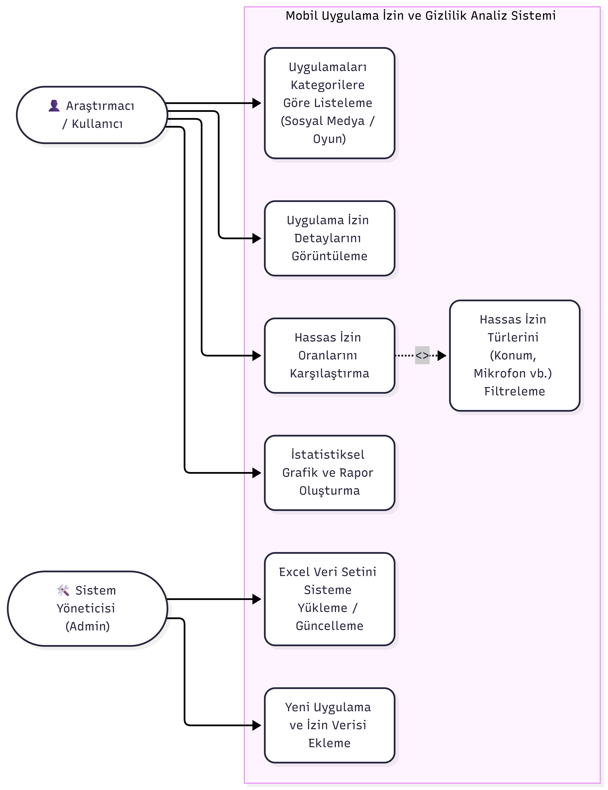
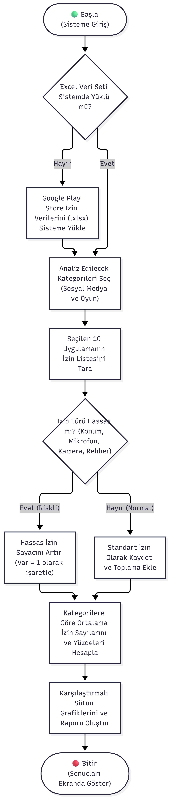
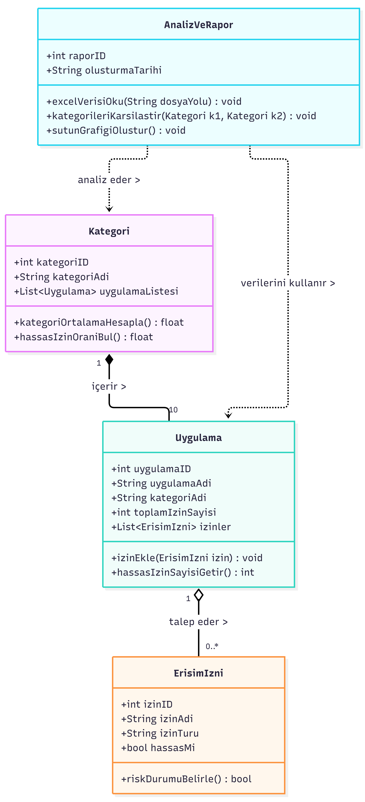

# MOBIL-UYGULAMA-GIZLILIK-ANALIZI
# Popüler Mobil Uygulamaların İzin Talepleri ve Veri Gizliliği Kapsamında Karşılaştırılması

Bu proje, Google Play Store üzerinde en çok indirilen popüler **Sosyal Medya** ve **Mobil Oyun** uygulamalarının talep ettiği erişim izinlerini (konum, mikrofon, kamera, rehber vb.) inceleyerek veri gizliliği kapsamında karşılaştırmayı amaçlamaktadır.

## 📊 Sistem Mimarisi ve UML Diyagramları
Sistemin yazılım mimarisini, veri yapısını ve işleyişini modellemek amacıyla aşağıdaki UML diyagramları hazırlanmıştır:

### 1. Use Case Diagram (Kullanım Durumu Diyagramı)
Araştırmacı (Kullanıcı) ve Sistem Yöneticisi (Admin) aktörlerinin sistem üzerinde gerçekleştirebileceği kategori listeleme, izin inceleme, veri yükleme ve raporlama işlemlerini gösterir.

---

### 2. Activity Diagram (Etkinlik Diyagramı)
Excel veri setinin sisteme yüklenmesinden başlayarak, uygulama izinlerinin taranması, hassas izinlerin ayrıştırılması ve karşılaştırmalı sütun grafiklerinin üretilmesine kadar geçen iş sürecini ve karar noktalarını modeller.

---

### 3. Class Diagram (Sınıf Diyagramı)
Sistemin temel yapısını oluşturan `Kategori`, `Uygulama`, `ErisimIzni` ve `AnalizVeRapor` sınıflarını, bu sınıfların özelliklerini, metotlarını ve aralarındaki ilişkileri gösterir.

